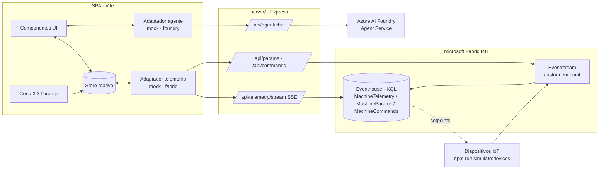

# 🏭 IoT Factory Dashboard — 3D Monitoramento de Chão de Fábrica

Dashboard 3D interativo para monitoramento IoT de máquinas em um chão de fábrica, construído com Three.js.

## 🚀 Como usar

Abra o arquivo `index.html` em qualquer navegador moderno:

```bash
# Windows
start index.html

# Ou simplesmente dê duplo clique no arquivo
```

**Navegação:** Arraste para orbitar, scroll para zoom.

### 🛡️ Proposta visual — Escolta armada (`index-escolta-armada.html`)

Abra [index-escolta-armada.html](index-escolta-armada.html) no navegador para visualizar a proposta de monitoramento de veículos e equipes em deslocamento. A página preserva a identidade do projeto: fundo escuro, azul GPS, cartões de indicadores, painéis laterais e barra de status. As versões industriais permanecem inalteradas.

- **Visão central:** mapa vetorial em perspectiva, percurso ilustrativo, veículos selecionáveis e progresso da jornada.
- **Animação:** comboio com dois veículos de escolta e um caminhão percorre a rota em loop, com faróis, rastro luminoso, fluxo de luz e pulso de localização no veículo selecionado. As posições animadas são ilustrativas e independentes dos indicadores fixos.
- **Painel esquerdo:** operação, origem/destino, veículos e check-in das equipes.
- **Painel direito:** telemetria do veículo selecionado, alerta de bateria e histórico.
- **Interações:** selecione veículos na lista ou no mapa; simule a ciência do alerta para atualizar o contador e o histórico sem remover a condição de bateria baixa.
- **Responsivo:** os painéis são empilhados em telas menores; seleção e botões também funcionam pelo teclado.
- **Controle de movimento:** botão para pausar/reproduzir; apontar para um marcador ou focá-lo pelo teclado pausa o movimento para facilitar a seleção. A animação inicia pausada quando o sistema solicita movimento reduzido e é suspensa enquanto a aba está oculta.

Todos os indicadores são fictícios e estáticos, com referência em 28/09/2026 às 14:40 BRT; apenas a cena do mapa é animada. O mapa é esquemático, sem escala, coordenadas ou posicionamento real. Não há autenticação, comunicação com equipes, envio de comandos ou integração de telemetria. A ciência do alerta existe apenas na página atual; recarregar reinicia a demonstração. O protótipo usa HTML, CSS e SVG locais, sem dependências externas.

### ✨ Versão 2 — Cena 3D Cinematic (`index-v2.html`)

Mesma moldura de monitoramento, mesmos dados mock e mesmo painel/comandos; muda apenas a cena 3D:

- **Render cinematográfico:** reflexos de ambiente (PMREM), bloom, contorno azul no ativo selecionado, névoa e sombras suaves.
- **Galpão detalhado:** piso de concreto texturizado, faixas de circulação, zonas de segurança zebradas, paredes de vidro, luminárias suspensas com feixes de luz, painel LED "Grupo GPS" e poeira no ar.
- **Máquinas animadas:** CNC com janela e spindle girando, robôs de 6 eixos articulados (ROB-003 caído/offline), esteiras com correia e caixas em movimento, empilhadeiras com rodas, garfo e giroflex, injetoras com cilindros aquecidos (INJ-002 pulsando), prensa com curso do martelo e cortina de luz, célula de solda com faíscas e arco elétrico.
- **Sinalização IoT:** torre de luz (andon) e tela IHM com gráfico ao vivo em cada máquina; feixe holográfico sobre ativos em alerta/offline.
- **Câmera:** entrada cinematográfica e "modo vitrine" (órbita automática após 20 s sem interação).

```bash
start index-v2.html
```

### ⚡ Versão SPA — reativa, Fabric RTI e assistente Foundry (`app/`)

Aplicação de página única (Vite + JavaScript modular, sem framework) construída sobre a cena da v2, com identidade visual **AI Fabric** (marca própria e paleta teal/violeta, sem logo ou referências ao Grupo GPS). Por padrão roda **100% mock**; as integrações reais são ligadas pelo `.env`.

```bash
npm install
npm run dev          # SPA em http://localhost:5173 (mock: simulador + agente local)
npm run dev:all      # SPA + proxy /api (necessário para Fabric/Foundry)
npm run build        # gera dist/ — `npm run server` também entrega a SPA buildada
```

**Funcionalidades**

1. **Ajuste de parâmetros** — no painel da máquina, **⚙️ Ajustar parâmetros** abre uma janela com os setpoints do tipo de máquina: modo (Automático/Manual/Pausado/Desligado), velocidade, temperatura alvo, limites de alarme de temperatura e vibração e tempo de ciclo. Faixas e rótulos variam por tipo, a validação acontece em tempo real, **Restaurar padrão** volta aos valores de fábrica, **Cancelar**/Esc desfaz e **Aplicar** (ou Ctrl+Enter) publica.
2. **Interface reativa** — um store central (`app/src/store.js`) notifica os componentes por tópico. Enquanto você edita, a **pré-visualização** já recalcula status, motivos, alertas, HUD, KPIs, lista de ativos, andon e IHM 3D e velocidade das animações. Depois de aplicar, o dispositivo recebe os setpoints e a telemetria **converge** para o novo ponto de equilíbrio (ex.: `SLOW_DOWN` na INJ-002 reduz a temperatura até sair do alerta). Os comandos (`PAUSE`, `EMERGENCY_STOP`, `RESUME`…) alteram o estado de fato.
3. **Integração Fabric Real-Time Intelligence** — camada de adaptadores em `app/src/integration/telemetry/` (`mock` | `fabric`) com o mesmo contrato. O painel **Sincronização Fabric RTI** mostra a fonte, o estado, os eventos recebidos/publicados, os dispositivos sincronizados e a latência.
4. **Assistente virtual agêntico** — botão 🤖 abre um chat com contexto ao vivo (máquina selecionada, telemetria, setpoints e alertas), sugestões contextuais e o botão **Perguntar** no painel. O modo `mock` usa uma base de conhecimento local; o modo `foundry` conversa com um agente do **Azure AI Foundry** (threads persistem durante a conversa).

**Arquitetura**



As credenciais ficam **somente no proxy**: SAS do Eventstream e Entra ID via `DefaultAzureCredential` (`az login`, managed identity…) para Eventhouse e Foundry.

**Configuração (`.env`, a partir de `.env.example`)**

| Variável | Uso |
|---|---|
| `VITE_TELEMETRY_MODE` | `mock` (padrão) ou `fabric` |
| `VITE_AGENT_MODE` | `mock` (padrão) ou `foundry` |
| `FABRIC_EVENTSTREAM_CONNECTION_STRING` / `FABRIC_EVENTSTREAM_NAME` | Custom endpoint do Eventstream (protocolo Event Hubs) |
| `FABRIC_KUSTO_URI` / `FABRIC_KUSTO_DATABASE` | Query URI e banco KQL do Eventhouse |
| `FABRIC_TELEMETRY_TABLE` / `FABRIC_PARAMS_TABLE` / `FABRIC_POLL_MS` | Tabelas e intervalo de leitura |
| `FABRIC_LOOPBACK=true` | Sem Fabric: o proxy emula Eventstream+Eventhouse em memória (testa o modo `fabric` de ponta a ponta) |
| `FOUNDRY_PROJECT_ENDPOINT` / `FOUNDRY_AGENT_ID` | Endpoint do projeto (`https://<recurso>.services.ai.azure.com/api/projects/<projeto>`) e ID do agente (`asst_…`) |
| `FOUNDRY_API_VERSION` | Versão da API do Agent Service (padrão `v1`) |

**Setup do Fabric RTI**

1. Crie um **Eventhouse** e, no banco KQL, as tabelas:
   ```kusto
   .create table MachineTelemetry (eventType:string, machineId:string, ts:datetime, temp:real, vib:real, usage:int, mode:string, speed:int)
   .create table MachineParams (eventType:string, machineId:string, ts:datetime, source:string, mode:string, speed:int, targetTemp:real, tempLimit:real, vibLimit:real, cycleTime:int)
   .create table MachineCommands (eventType:string, machineId:string, ts:datetime, source:string, command:string)
   ```
2. Crie um **Eventstream** com uma fonte **Custom endpoint** e copie a connection string (Event Hub) para o `.env`.
3. Adicione destinos Eventhouse roteando por `eventType` (filtro): `telemetry` → `MachineTelemetry`, `params` → `MachineParams`, `command` → `MachineCommands`.
4. Rode `npm run simulate:devices`: os 16 dispositivos enviam telemetria ao Eventstream e aplicam os setpoints publicados pela SPA (lidos de `MachineParams`), fechando o ciclo SPA → Eventstream → Eventhouse → dispositivo → telemetria.
5. Defina `VITE_TELEMETRY_MODE=fabric` e rode `npm run dev:all`. O proxy consulta `arg_max(ts, *) by machineId` e transmite por SSE. Máquinas sem leitura há mais de `FABRIC_STALE_SEC` (15 s) aparecem como **sem comunicação**.

**Setup do agente no Azure AI Foundry**

1. Em um projeto do Foundry, crie um **agente** (ex.: `gpt-4o-mini`) com instruções como:
   > Você é o assistente de manutenção e operação da Linha A da plataforma AI Fabric. Explique o funcionamento das máquinas (CNC, robôs, esteiras, empilhadeiras, injetoras, prensa e solda), interprete alarmes de temperatura/vibração e recomende ajustes de parâmetros e manutenção. Use somente os valores do contexto em tempo real enviado em cada execução; nunca invente leituras. Responda em português, de forma objetiva, citando o código da máquina.
2. Opcional: anexe manuais das máquinas via **File search** como base de conhecimento.
3. Conceda ao usuário/identidade do proxy o papel **Azure AI User** no projeto, preencha `FOUNDRY_PROJECT_ENDPOINT` e `FOUNDRY_AGENT_ID` e defina `VITE_AGENT_MODE=foundry`.

O contexto ao vivo da planta é enviado como `additional_instructions` a cada execução, e o histórico fica na thread do agente.

**Estrutura**

```
app/                     SPA (Vite root)
  src/shared/            modelo de máquinas, regras de status e simulação (compartilhados com o servidor)
  src/store.js, state.js store reativo + ações
  src/scene/scene.js     cena 3D da v2, agora dirigida pelo estado
  src/ui/                painel, modal de parâmetros, assistente, painéis laterais
  src/integration/       adaptadores telemetry (mock|fabric) e agent (mock|foundry)
server/                  proxy Express (Fabric RTI + Foundry) e simulador de dispositivos
```

## 📊 Dados Mockados

Todos os dados estão no array `MACHINES` no início do script (linha ~50 do `index.html`).

### Máquinas disponíveis

| ID | Nome | Tipo | Status | Observação |
|----|------|------|--------|------------|
| CNC-001 | Torno CNC 1 | cnc | ✅ Online | |
| CNC-002 | Torno CNC 2 | cnc | ✅ Online | |
| CNC-003 | Fresa CNC 1 | cnc | ⚠️ Alerta | Temperatura elevada (89°C) |
| ROB-001 | Braço Robô A | robot | ✅ Online | Gira continuamente |
| ROB-002 | Braço Robô B | robot | ✅ Online | Gira continuamente |
| ROB-003 | Braço Robô C | robot | ❌ Offline | |
| CVY-001 | Esteira 1 | conveyor | ✅ Online | |
| CVY-002 | Esteira 2 | conveyor | ✅ Online | |
| CVY-003 | Esteira 3 | conveyor | ⚠️ Alerta | Vibração elevada |
| FKL-001 | Empilhadeira 1 | forklift | ✅ Online | 🔄 Em movimento |
| FKL-002 | Empilhadeira 2 | forklift | ✅ Online | 🔄 Em movimento |
| FKL-003 | Empilhadeira 3 | forklift | ⚠️ Alerta | 🔄 Em movimento |
| INJ-001 | Injetora 1 | injector | ✅ Online | |
| INJ-002 | Injetora 2 | injector | ⚠️ Alerta | Temperatura crítica (210°C) |
| PRE-001 | Prensa Hidráulica | press | ✅ Online | |
| WLD-001 | Solda Robótica | welder | ✅ Online | |

### Métricas por máquina

Cada máquina possui:
- **Temperatura** (°C) — simulada conforme o tipo
- **Vibração** (mm/s) — indicador de desgaste
- **Uso** (%) — percentual de utilização

### Status

- 🟢 **Online** — operando normalmente
- 🟡 **Alerta** — parâmetro fora do ideal (ex: temperatura ou vibração alta)
- 🔴 **Offline** — máquina desligada ou sem comunicação

## 🎮 Funcionalidades

### Moldura de monitoramento (mock)

A animação 3D roda dentro de um container central, cercado pela interface de operação:

- **Topbar** — logo do Grupo GPS, identificação da unidade/turno, relógio e o bloco do **operador autenticado** (nome, matrícula, perfil, badge "Autenticado", botão de encerrar sessão)
- **Painel esquerdo** — dados da sessão (usuário, perfil de acesso, login, expiração, permissão de comando), passo a passo de como operar o painel, procedimento em caso de alerta e contatos do turno
- **Painel direito** — alertas ativos, indicadores do turno (disponibilidade, OEE, produção) e checklist do operador
- **Barra de status** — aviso de ambiente de demonstração, broker MQTT, gateways de borda, latência e última atualização

> ⚠️ Todos os dados — inclusive o operador autenticado, login e sessão — são **mockados**. Não há autenticação real.

### Interações

1. **Clique em qualquer máquina** — abre painel com métricas em tempo real
2. **Envio de comandos** — selecione um comando e clique "Enviar" para simular controle
3. **Empilhadeiras animadas** — 3 veículos percorrendo trajetos predefinidos
4. **Braços robóticos** — animação de rotação contínua
5. **HUD** — contagem de máquinas por status no topo
6. **Paredes de vidro** — ambiente de galpão industrial

### Comandos disponíveis

- `EMERGENCY_STOP` — Parada de emergência
- `PAUSE` — Pausar operação
- `RESUME` — Retomar operação
- `CALIBRATE` — Calibrar sensores
- `SPEED_UP` — Aumentar velocidade
- `SLOW_DOWN` — Reduzir velocidade
- `CYCLE_START` — Iniciar ciclo

## 🛠️ Tecnologia

- [Three.js](https://threejs.org/) — Renderização 3D via WebGL
- CSS2DRenderer — Labels sobrepostos
- OrbitControls — Navegação livre pela cena